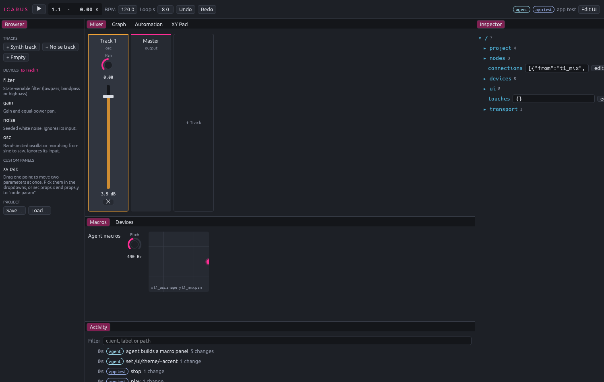
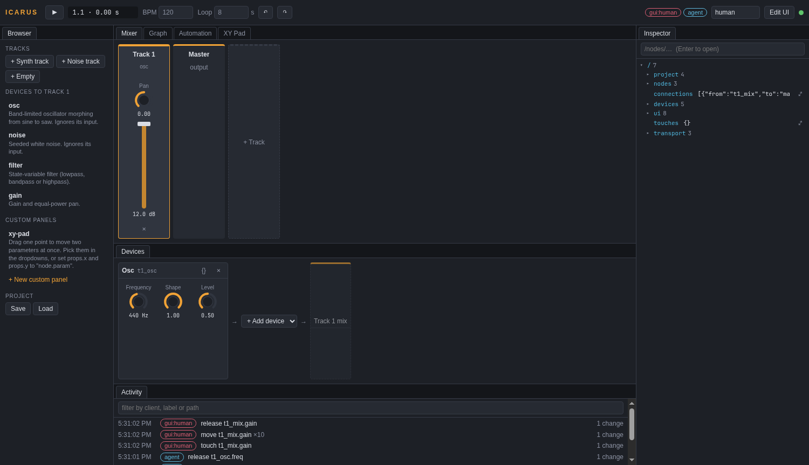

# Icarus

An open, modular DAW for Linux, built from scratch so that **agents, people, controllers and extensible rigs are all equal clients**.

Every part of the signal chain is raw, addressable and changeable through one protocol. No client has a private API, not even the GUI. An agent can do anything a person can, with the same fingers: it touches a knob, moves it, hears the result live, and lets go. It can also experiment before touching anything: it forks the project, renders dozens of variants in parallel, and measures what each parameter does to the sound.

> **Status: early prototype.** The core works: a deterministic engine, live PipeWire playback, transactions, gestures, undo with attribution, the path tree, change events with subscriptions, offline forked rendering and probing, MCP, OSC, WebSocket and JSON-socket adapters, and two GUIs (a native desktop app and a browser GUI) that are both rewritable data. There's no MIDI or sequencer yet. See [ROADMAP](#roadmap).



## Try it

```sh
cargo build --release
./target/release/icarus            # the native app, with live audio
```

Add a synth track, press play (space), and turn knobs. The app also serves the browser GUI for the same session at http://127.0.0.1:7880, so a tablet or second screen can join. To let Claude Code into the **same** session, so you can both work on it at once:

```sh
claude mcp add icarus -- /path/to/icarus mcp --connect 127.0.0.1:7878
```

Its hand shows on the knobs it's holding, its changes appear in Activity under its own name, and Ctrl+Z undoes whatever was last done, by anyone.

To put Icarus in your app launcher:

```sh
cargo install --path crates/icarus                         # installs `icarus` to ~/.cargo/bin
cp packaging/icarus.desktop ~/.local/share/applications/   # needs ~/.cargo/bin on your PATH
```

Prefer the browser? `icarus gui` runs only the browser GUI. There's also a headless demo:

```sh
./target/release/icarus demo
```

The demo builds a saw → filter → gain patch, records a filter sweep as a gesture, renders it to `icarus-demo.wav`, proves renders are bit-identical across block sizes, and probes 15 forked variants in parallel to rank which control moves which feature:

```
5. Probe: 5 cutoffs x 3 resonances on forked copies, rendered in parallel
   15 variants in 37 ms. Strongest effects:
   filt.cutoff      -> centroid_hz    +3208.5 over full range
   filt.resonance   -> centroid_hz     +425.7 over full range
```

## Two GUIs, one session, and agents in either

Icarus has two interfaces, and you can use both at the same time:

- **The native app** (`icarus`) is a Rust desktop app built with egui. It's fast, has a real window and desktop integration, and is the base for native plugin windows and heavy views like waveforms.
- **The browser GUI** (`icarus gui`, or http://127.0.0.1:7880 while the app runs) works from any device on the network and runs custom panels written as web code. It's also the path to VR through WebXR.

Neither GUI has special access. Both are protocol clients, exactly like agents, so **agent access never depends on which GUI is open**: agents connect to the session, not to a window. A change from either GUI or from any agent shows up in all of them immediately. `icarus --connect 127.0.0.1:7878` opens a second native window on a session that's already running.



## The GUI is data, so anyone can change it

Both GUIs build themselves from the same document in the project, at `/ui`:

| Path | What it controls |
|---|---|
| `/ui/layout` | The grid: `columns`, `rows`, and named `areas` |
| `/ui/panels/<id>` | Each panel: `type`, which `area` it sits in, `title`, `order`, `props` |
| `/ui/panels/<id>` with `"type": "controls"` | A panel **composed from widgets by data alone**: knobs, faders, XY pads, labels, buttons. Native in both GUIs. |
| `/ui/tracks` | How the graph is read as tracks: `{name, color, devices: [node ids], mix}` |
| `/ui/theme` | Every colour, font and radius (CSS variables) |
| `/ui/keys` | Key bindings, e.g. `"ctrl+z": "undo"` |
| `/ui/components/<type>` | **Code** for new panel types, written by people or agents |
| `/ui/graph/positions` | Where nodes sit in the Graph view |

Change any of it from anywhere, and every open GUI rebuilds:

```jsonc
{"type": "set", "path": "/ui/theme/--accent", "value": "#7ee787"}            // restyle
{"type": "set", "path": "/ui/panels/log/area", "value": "right"}             // rearrange
{"type": "set", "path": "/ui/layout/columns", "value": "160px 1fr 0px"}      // hide a column
{"type": "set", "path": "/ui/panels/macros", "value": {"type": "controls", "area": "bottom", "props": {"widgets": [
  {"knob": "t1_osc.freq", "label": "Pitch"}, {"xy": ["t1_filter.cutoff", "t1_filter.resonance"]},
  {"button": "Drop", "request": {"type": "set", "path": "/nodes/t1_filter/params/cutoff", "value": 200}}]}}}
{"type": "transaction", "commands": [                                        // invent a panel in code (browser)
  {"op": "set_ui", "path": "/components/meter", "value": {"source": "root.textContent = '…'"}},
  {"op": "set_ui", "path": "/panels/meter", "value": {"type": "meter", "area": "bottom"}}]}
```

`controls` panels are the way to give a panel to both GUIs at once, with fast native widgets. Panels written as code (`/ui/components`) run in the browser GUI; the native app shows them with an "Open in browser" button for now.

Custom panels run in a sandboxed iframe and can do exactly what any client can (`icarus.request/get/set/gesture/on`) and nothing more. Their requests are attributed to the panel, for example `gui:human/xy`. The stock XY pad ([`xy-pad.js`](crates/icarus-model/ui/xy-pad.js)) is one of these: it configures itself by writing its own props.

In either GUI, **Edit UI** (Ctrl+E) exposes the same thing to people: add, move and remove panels, edit the layout, theme and keys as JSON, or write a new panel and see it live. The **Inspector** shows the whole session as the path tree, and you can edit any value there. To hack on the built-in panels themselves, run `icarus gui --gui-dir crates/icarus/gui` and reload the page after each edit.

The built-in panels, in both GUIs, are Transport, Browser, Mixer, Devices, Graph (patch anything to anything), Automation, Inspector, Activity and Controls. The browser GUI also has the XY Pad custom panel.

## Connect anything

One `serve` process runs one session. Turn on as many adapters as you like; they all share it.

```sh
icarus serve --live --mcp --osc 9000 --ws 127.0.0.1:7879 --socket 127.0.0.1:7878 [--project song.json]
```

| Adapter | For | Docs |
|---|---|---|
| `--mcp` | Claude Code and any other MCP-capable agent | [`crates/icarus/src/mcp.rs`](crates/icarus/src/mcp.rs) |
| `--osc <port>` | TouchOSC, VR (Unity/Unreal/Godot OSC), Max/Pd, hardware | [`crates/icarus/src/osc.rs`](crates/icarus/src/osc.rs) |
| `--ws <addr>` | The GUI, browsers, WebXR, game engines (HTTP and WebSocket on one port) | [`crates/icarus/src/ws.rs`](crates/icarus/src/ws.rs) |
| `--socket <addr>` | Scripts, custom agents: line-delimited JSON | [`crates/icarus/src/socket.rs`](crates/icarus/src/socket.rs) |
| `--live` | Hear every change in real time through PipeWire | [`crates/icarus-pipewire`](crates/icarus-pipewire) |

**Claude Code**, in its own session, or bridged into a running one (`icarus gui` opens a socket on 127.0.0.1:7878):

```sh
claude mcp add icarus -- /path/to/icarus mcp                          # its own session
claude mcp add icarus -- /path/to/icarus mcp --connect 127.0.0.1:7878 # join the GUI's session
```

You can then ask it, for example, to "build a bass patch, probe the filter, and sweep it in over 4 seconds" while you play with the same controls from the GUI or TouchOSC.

## Everything is a path

```
/project/{seed,tempo_bpm,length_s}
/nodes/<id>                              {"kind": "filter"} adds, null removes
/nodes/<id>/params/<param>               plain units (Hz, dB)
/nodes/<id>/params/<param>/normalized    0..1, for faders and VR hands
/nodes/<id>/params/<param>/spec          range, curve, unit, what it does to the sound
/nodes/<id>/automation/<param>
/connections
/devices/<kind>
/ui/...                                  the GUI itself: layout, panels, tracks, theme, keys, components
/touches                                 who is holding which control right now
/transport/{playing,live,position_s}     set playing to true to start playback
```

Over the socket, `{"type":"set","path":"/nodes/filt/params/cutoff","value":800}`. Over OSC, `/icarus/nodes/filt/params/cutoff/normalized 0.4`. Over MCP, the `set` tool. Every write becomes validated, undoable commands attributed to the client that sent it:

```json
{"undo": [{"client": "osc:192.168.1.20:9001", "label": "gesture filt.cutoff"},
          {"client": "mcp:claude-code",       "label": "add reverb send"}]}
```

## Watch everything

Any client can subscribe to path prefixes and get every change pushed to it, whoever made it:

```jsonc
// → over WebSocket or the JSON socket
{"id": 1, "type": "subscribe", "paths": ["/nodes/filt", "/touches"]}
// ← while an agent sweeps the filter from MCP
{"event": {"seq": 2, "client": "mcp:claude-code", "label": "touch filt.cutoff",
           "changes": [{"path": "/touches/filt/cutoff", "value": "mcp:claude-code"}]}}
{"event": {"seq": 3, "client": "mcp:claude-code", "label": "move filt.cutoff",
           "changes": [{"path": "/nodes/filt/params/cutoff", "value": 2000.0, "normalized": 0.667}]}}
{"event": {"seq": 4, "client": "mcp:claude-code", "label": "release filt.cutoff",
           "changes": [{"path": "/touches/filt/cutoff", "value": null}]}}
```

`/touches` is presence: it shows whose hand is on which control, so a VR scene can draw the agent's hand on the knob. OSC surfaces send `/icarus/subscribe /nodes/filt [reply_port]` and get `/icarus/nodes/filt/params/cutoff 2000` plus `.../normalized 0.667` back, which motorised faders and TouchOSC need. Agents on MCP use the `subscribe` and `events` tools.

## Why determinism matters

The same project always renders to **bit-identical** audio, whatever the block size, machine or thread count. Parameters resolve per frame from the absolute sample position, every random source is seeded from the project, and devices hold no wall-clock state. That's what makes **forked rendering** useful: when an agent renders two copies that differ in one knob, any difference in the output is caused by that knob. Tests in [`icarus-render`](crates/icarus-render/src/lib.rs) enforce it.

## Layout

| Crate | Role |
|---|---|
| `icarus-model` | Project document and the protocol (`Request`, `Command`, `Gesture`). Plain data. |
| `icarus-engine` | Deterministic audio graph, devices, parameter specs, lock-free realtime runner |
| `icarus-analysis` | Features that describe audio to a model: levels, crest, centroid, band balance, width |
| `icarus-render` | Offline forked rendering, taps on any node, parallel probing and sensitivity |
| `icarus-session` | Transactions, gestures, undo with attribution, the path tree, change events and subscriptions |
| `icarus-pipewire` | Live output |
| `icarus-client` | Connect to a session in this process or over its socket (used by MCP and the app) |
| `icarus-app` | The native desktop app (egui), a protocol client that builds itself from `/ui` |
| `icarus` | CLI, adapters (MCP, OSC, WebSocket, JSON socket), and the browser GUI in `gui/` |

Read [ARCHITECTURE.md](ARCHITECTURE.md) for the design rules and how to extend each layer.

## Roadmap

- **Live meters and taps as subscribable paths** (levels and spectra streamed to VR and agents).
- **Authentication** for the network adapters.
- **Clips, MIDI and a sequencer**, plus a clip grid and piano roll in the GUI.
- **Device plugins:** CLAP and LV2 hosting out of process, and WASM/Faust devices that agents can write and hot-load.
- **State-preserving graph swaps** (today a structural edit resets DSP state and can click).
- **Differentiable twins** of built-in devices, for gradient-based matching ("make it sound like this reference").
- **Semantic hearing:** audio-text embeddings alongside the DSP features.
- **WebXR GUI** on the same `/ui` document.
- **Native app:** plugin editor windows, waveform and spectrum views, and embedded web views so code-based custom panels run natively too.

## License

GPL-3.0-or-later. The core stays open, and so do its forks.
